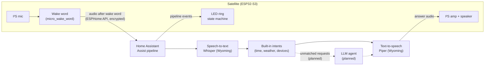

# Local Voice Satellite

A DIY voice satellite for [Home Assistant](https://www.home-assistant.io/): an ESP32-S3 with an I²S microphone, an I²S amplifier and an LED ring in a 3D-printed case. The wake word runs on the device. Speech-to-text and text-to-speech run on my own server. No audio goes to a cloud service.


<!-- PHOTO NEEDED: images/v2-hero.jpg: the assembled V2 satellite on a plain desk, LED ring lit amber, 3/4 front view from slightly above, neutral background, nothing else in frame. Replaces the render above. -->

This is a **portfolio showcase and a reference design**, not a kit. It documents one working build and the reasoning behind it: what I chose, why, what broke and what I'd do differently. It's meant for people who want to build something similar and are happy to make their own decisions. It is not a step-by-step tutorial.

## Why

I wanted a voice assistant for my home that works like a smart speaker but stays private: no always-listening cloud device, and no recordings leaving the house. Home Assistant's voice pipeline makes that possible with local speech-to-text and text-to-speech. What was missing was a satellite I understood end to end and could repair, so I built one.

## Result

The V2 satellite works. It hears "Hey Jarvis" on the device, Home Assistant turns the request into text and the answer into speech locally, and the answer plays on the satellite while the LED ring shows each stage. Simple requests take about 5–10 s end to end, down from about a minute right after assembly. I haven't measured the stage times yet. What V2 taught me (a mic mount that broke under the wire forces, speaker hiss, LEDs without a level shifter) went into a V3 PCB and case, which are designed and checked in code only, not built.

## Status

| Part | Status |
|---|---|
| **Satellite V2 (hand-wired)**: perfboard electronics in the V2 case | Built by me, working. Wake word, answers and audio all work. |
| **V2 enclosure** | Printed and assembled. Everything fit. |
| **V2 firmware** (ESPHome) | Running on the V2 satellite. The published copy is sanitised and passes ESPHome's config validation (2026.10.2). |
| **Satellite V3 (custom PCB)** | **Unverified design (rev A).** Designed, not fabricated, not tested, and it may never be built. Only code-level checks were run ([details](hardware/v3-pcb/README.md#what-was-checked)). |
| **V3 enclosure** | Unverified design, never printed. |
| **V3 firmware** | Draft for the unbuilt board. Passes ESPHome's config validation, never flashed. |
| **Voice pipeline**: on-device wake word, local STT (Whisper) and TTS (Piper) | Working. Observed end-to-end latency for simple requests (time, weather): **about 5–10 s**, down from about 1 min right after assembly. The stage times haven't been measured yet. |
| **LLM agent** for open questions | **Planned.** Not connected yet. |

### Next steps
- Measure the stage times (wake → end of speech → STT → intent → TTS) in Home Assistant's pipeline debug view, and only then decide what to optimise.
- Connect an LLM agent behind Home Assistant's built-in intents.
- Decide whether V3 gets built. If it does, start with the [must-verify list](hardware/v3-pcb/README.md#must-verify-before-ordering).

## Features

- **On-device wake word** ("Hey Jarvis", [micro_wake_word](https://esphome.io/components/micro_wake_word/)). Audio only streams to Home Assistant after the wake word.
- **Fully local pipeline**: Whisper for speech-to-text and Piper for text-to-speech, through Home Assistant's [Wyoming](https://www.home-assistant.io/integrations/wyoming/) integration.
- **LED ring state machine**: breathing while listening, a circling comet while thinking, a soft glow while answering, a red blink on errors and dim red while Home Assistant is disconnected. Every stage has a timeout, so the ring can't hang.
- **Amplifier power gating**: the amp's shutdown pin is driven by the firmware, so the speaker is silent between answers (no idle hiss).
- **Sealed speaker chamber** with TPU gaskets, the speaker firing upwards through a grille, and the mic on the front wall at 90° to it.
- **Designed as code**: the case is parametric [build123d](https://github.com/gumyr/build123d) code with automated collision, seal and assembly checks. The V3 PCB is generated by a Python toolkit into a KiCad 9 project.

## Architecture



The diagram shows roles, not machines. More in [docs/architecture.md](docs/architecture.md).

## Hardware at a glance (V2, the working build)

| Part | Notes |
|---|---|
| ESP32-S3 devkit, N16R8 (16 MB flash, 8 MB octal PSRAM) | micro_wake_word needs the PSRAM |
| INMP441 I²S MEMS mic breakout (round) | I²S bus 0. End of life; the ICS-43434 is the usual replacement |
| MAX98357A I²S class-D amp breakout | I²S bus 1, gain 9 dB (GAIN pin open) |
| 40 mm full-range speaker | 40 × 40 mm flange, 32 mm hole pitch |
| WS2812B strip, 144 LED/m, 5 V | 40 LEDs (about 28 cm) around the inside of a clear plinth |
| USB-C PD trigger board, set to 5 V | one 5 V / GND star point for every module |
| 40 × 60 mm perfboard, 2 electrolytics (470 µF, 1000 µF), 10 kΩ × 2, 330 Ω | |
| M3 button-head screws (ISO 7380): 5 × M3×10, 4 × M3×8, 4 × M3×20 | threaded straight into PETG, no inserts |
| Filament: PETG black, PCTG clear, TPU black | printed on a Bambu Lab A1 mini, 0.4 mm nozzle |

Wiring diagram and pin table: [hardware/v2](hardware/v2/README.md). The V3 BOM with part numbers is in [hardware/v3-pcb/bom.csv](hardware/v3-pcb/bom.csv).

## Build and run

Tested with Python 3.12 and ESPHome 2026.10.2, from the repository root. The generators rewrite the committed outputs in place.

```bash
# Firmware: validate the V2 config. In secrets.yaml, replace the placeholder API key with a
# generated one (the command is in the file) and fill in your Wi-Fi details.
pip install esphome
cp firmware/esphome/secrets.example.yaml firmware/esphome/secrets.yaml
esphome config firmware/esphome/voice-satellite-v2.example.yaml

# V3 PCB (unverified design): regenerate, then read the outputs back with independent parsers
pip install shapely numpy matplotlib gerbonara kiutils
python3 hardware/v3-pcb/source/satellite_v3_pcb.py
python3 hardware/v3-pcb/source/check_outputs.py

# Cases: regenerate and check (V3 reads the board geometry written by the PCB step)
pip install build123d trimesh pyvista networkx
python3 enclosure/v2/source/case_v2.py && python3 enclosure/v2/source/check_case_v2.py
python3 enclosure/v3/source/case_v3.py && python3 enclosure/v3/source/check_case_v3.py
```

Flashing and adopting the device in Home Assistant: [firmware/esphome](firmware/esphome/README.md). Printing and assembly: [enclosure](enclosure/README.md) and [build notes](docs/build-notes.md). What reproduces exactly and what doesn't: [enclosure](enclosure/README.md#regenerate) and [V3 PCB](hardware/v3-pcb/README.md#files).

## Repository map

| Path | What's in it |
|---|---|
| [docs/](docs/) | [architecture](docs/architecture.md) · [design decisions](docs/design-decisions.md) · [wiring](docs/wiring.md) · [build notes](docs/build-notes.md) · [lessons learned](docs/lessons-learned.md) · [how it was built](docs/how-it-was-built.md) |
| [hardware/v2/](hardware/v2/README.md) | Hand-wired V2: wiring diagram (SVG) and pin table |
| [hardware/v3-pcb/](hardware/v3-pcb/README.md) | Custom PCB, **unverified rev A**: generator source, KiCad 9 project, Gerbers, BOM, renders, check report |
| [enclosure/](enclosure/README.md) | V2 (built) and V3 (unverified) cases: CAD source, STL in print orientation, STEP, renders, print settings |
| [firmware/esphome/](firmware/esphome/) | ESPHome example configs for V2 and V3 and a `secrets.example.yaml` |
| [images/](images/) | Photos (EXIF stripped) |

## How it was built

This project was built with AI assistance (Claude by Anthropic). I defined the requirements, chose the components, measured the real parts, specified and reviewed the designs, and printed, soldered, assembled and tested the hardware. The enclosure and the V3 PCB were generated **as code with AI assistance**, and the firmware, the wiring and soldering guides, the wiring diagram and the doc drafts were written with AI support. I reviewed, adapted and tested all of it. The full split of who did what is in [docs/how-it-was-built.md](docs/how-it-was-built.md).

## Licence

This is open source and permissive: you can copy, modify and sell it, as long as you keep the copyright and licence notices.

| What | Licence |
|---|---|
| Firmware configs and all code, including the PCB and CAD generators and check scripts (`firmware/`, `hardware/v3-pcb/source/`, `enclosure/*/source/`, except Markdown files) | [MIT](LICENSE) |
| Hardware designs: PCB, KiCad project, Gerbers, BOM, STL/STEP, check reports and the wiring diagram (rest of `hardware/` and `enclosure/`, except Markdown files and renders) | [CERN-OHL-P-2.0](LICENSES/CERN-OHL-P-2.0.txt) |
| Documentation and images: every Markdown file (`*.md`, including the READMEs in `firmware/`, `hardware/` and `enclosure/`), `docs/`, `images/` and all renders | [CC BY 4.0](LICENSES/CC-BY-4.0.txt) |

© 2026 Daniel Bernet. If you build on this, a credit or a link back is appreciated. GitHub's "Cite this repository" uses [CITATION.cff](CITATION.cff).

### Third-party

These are used or referenced, not bundled, and they keep their own licences:
- [ESPHome](https://esphome.io/): firmware framework the configs are written for.
- [micro_wake_word models](https://github.com/esphome/micro-wake-word-models): the `hey_jarvis` model is downloaded by ESPHome at build time (Apache-2.0).
- [Home Assistant](https://www.home-assistant.io/) with its Wyoming integration, Whisper and Piper: the voice pipeline on the server side.
- [KiCad](https://www.kicad.org/): opens the generated project. No KiCad library files are included; the footprints in `satellite.pretty` are re-created from datasheet dimensions by the generator.
- Python tools used to generate and check the designs: [build123d](https://github.com/gumyr/build123d), shapely, numpy, matplotlib, gerbonara, kiutils, trimesh, networkx, pyvista, cairosvg.
- Component datasheets are linked from [hardware/v3-pcb/README.md](hardware/v3-pcb/README.md#datasheets), not copied.

## Project page

The write-up of this project is on my site: [dbernet.ch/projects/local-voice-satellite](https://dbernet.ch/projects/local-voice-satellite/).
