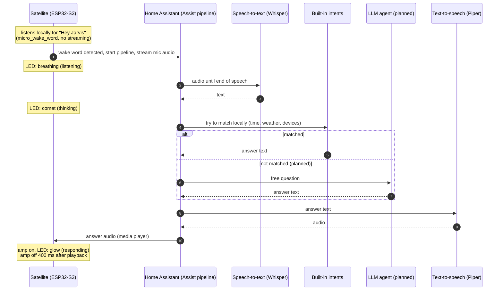

# Architecture

This is the high-level view: which role does what, and why the work is split this way. It deliberately leaves out machines, addresses and the server setup.

## Roles

| Role | Runs | Responsibility |
|---|---|---|
| **Satellite** | ESP32-S3 with ESPHome | Wake word on the device, mic capture (I²S bus 0), playback (I²S bus 1), amp power gating, LED feedback for each pipeline stage, watchdogs so the LEDs and the pipeline can't hang. Talks to Home Assistant over the ESPHome native API (encrypted with a per-device key). |
| **Home Assistant Assist pipeline** | Home Assistant | Orchestrates one voice interaction: end-of-speech detection, STT, intent handling, TTS, and sending the answer back to the satellite's media player. |
| **Speech-to-text** | Whisper via Wyoming | Turns the streamed audio into text. Runs on the CPU. |
| **Built-in intents** | Home Assistant | Answers fixed commands and simple questions (time, weather, devices) locally and quickly, without any LLM. |
| **LLM agent** | planned | Will take the requests the built-in intents can't match. Not connected yet. |
| **Text-to-speech** | Piper via Wyoming | Turns the answer text into audio. |

## Why this split

- **Wake word on the device.** The satellite only streams audio after it has heard the wake word, so nothing is sent while it's just sitting in the room. It also takes load off the server. micro_wake_word needs PSRAM, which is why the satellite uses an N16R8 ESP32-S3 (8 MB octal PSRAM).
- **The satellite stays simple.** All the language work (STT, intents, TTS, later the LLM step) is handled through Home Assistant. The satellite firmware doesn't change when the pipeline does.
- **Local intents before the LLM.** Commands like "what time is it" never need a language model. The planned LLM only gets what the built-in intents can't handle, which keeps simple requests fast and predictable.
- **One media path on the satellite.** All audio, voice answers and announcements alike, goes through one ESPHome media player. That gives exactly one place to switch the amplifier on and off.

## Latency

Observed end to end for simple requests (time, weather): about **5–10 s**. Right after assembly it was about **1 min**. I haven't measured the individual stages, so I can't say which stage changed. Measuring them in the pipeline's debug view is the next step ([lessons learned](lessons-learned.md#2-the-first-answers-took-about-a-minute)).

## Satellite firmware state machine

| Phase | LED | Entered on | Timeout |
|---|---|---|---|
| 0 idle | off | boot, end of pipeline | – |
| 1 listening | amber breathing | wake word / `on_listening` | 15 s |
| 2 thinking | amber comet | end of speech (`on_stt_vad_end`) | 45 s |
| 3 responding | amber glow with a slow shimmer | `on_tts_start` | 120 s |
| 4 error | two red blinks | `on_error` | – |
| 5 disconnected | dim red breathing | API client disconnected | – |

<!-- PHOTO NEEDED: images/v2-ring-thinking.jpg: the V2 satellite in a dim room with the amber comet ("thinking") visible in the light band, side view at table height, dark plain background, no screens or other light sources in frame. -->

The whole interaction has a hard limit of 180 s, after which the firmware stops the pipeline. A guard returns to idle 3 s after the pipeline ends if no answer audio is playing. The config is in [firmware/esphome](../firmware/esphome/).
