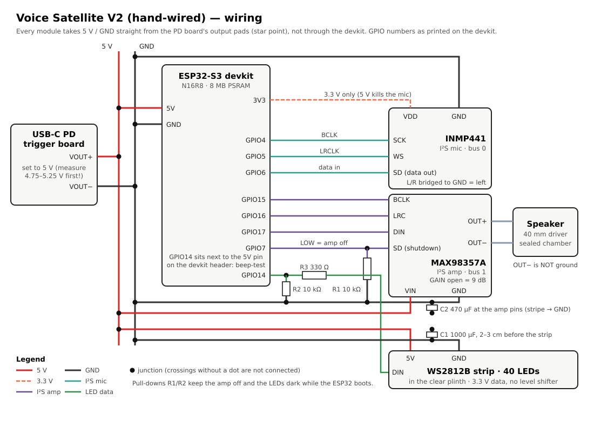

# Wiring (V2, hand-wired)

The diagram and the pin table are in [hardware/v2](../hardware/v2/README.md). This page explains the reasoning behind the wiring.

## Power: one star point

The USB-C PD trigger board's output pads are the only 5 V / GND distribution point. The devkit, the amp, the mic's ground and the LED strip each get their own red/black pair from those pads. The LED and amp current never flows through the devkit's pins or its thin traces.

- **Measure the trigger board's output with your actual charger before connecting anything.** It must read 4.75–5.25 V. A trigger board that negotiates 9 V or more destroys the ESP32, the amp and the LEDs.
- **Never plug USB into the devkit while it sits on the perfboard,** powered or not. With the trigger board on, two supplies meet on the 5 V pin. With it off, USB back-feeds the amp and the strip. Update over Wi-Fi (OTA). To flash over USB, pull the devkit out of its headers first.
- **Bulk capacitors:** 470 µF at the amp's VIN/GND pins covers its current peaks at high volume (crackle, resets), and 1000 µF a few cm before the strip protects the first LED at power-on. Together that's about 1.5 mF of inrush, which some chargers or power banks may not like. Test with the ones you'll actually use.

## Signals

| Bus | Signal | GPIO | Note |
|---|---|---|---|
| I²S 0 (mic) | SCK / WS / SD | 4 / 5 / 6 | Mic VDD from the devkit's **3V3**, never 5 V. L/R bridged to GND = left channel. |
| I²S 1 (amp) | BCLK / LRC / DIN | 15 / 16 / 17 | GAIN left open = 9 dB |
| Amp shutdown | SD | 7 | 10 kΩ to GND keeps the amp off during boot. With RST held, SD must read below 0.08 V. |
| LED data | DIN | 14 | 330 Ω in series, 10 kΩ to GND, 3.3 V logic level |

Pins to avoid on the ESP32-S3: 0/3/45/46 (strapping), 19/20 (USB), 26–32 (flash), 33–37 (octal PSRAM), 43/44 (UART).

## Traps worth knowing

- **"SD" means two different pins.** On the INMP441 it's the microphone's data *output*. On the MAX98357A it's the amp's *shutdown* input. Label both wires.
- **GPIO14 sits right next to the 5 V pin** on the usual DevKitC-1 style header. A solder bridge there puts 5 V on a 3.3 V pin. Check the gap under magnification and with a continuity beep.
- **OUT− on the amp is not ground.** The MAX98357A drives both speaker wires (bridge-tied load). Never connect OUT− to GND.
- **Don't tin wire ends that go into a screw terminal.** The solder slowly flattens under the screw and the joint works loose.
- **Electrolytics have a polarity.** The stripe is minus and goes to GND.

## Wire colours I used

There are six colours. The fixed roles are red = 5 V, black = GND and yellow = bit clock. Two wires break the rule and are tape-flagged: the mic's red VDD wire carries 3.3 V, and the speaker's black wire is amp OUT−, not ground. 22 AWG for the LED power pair, 26 AWG for the signals.
