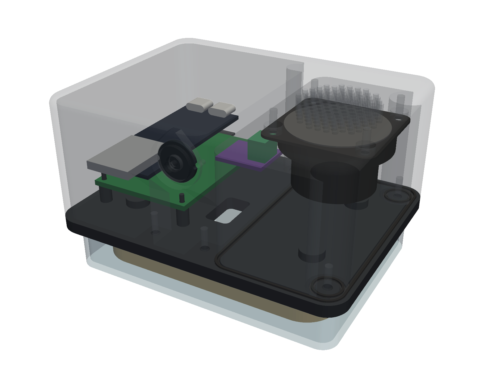
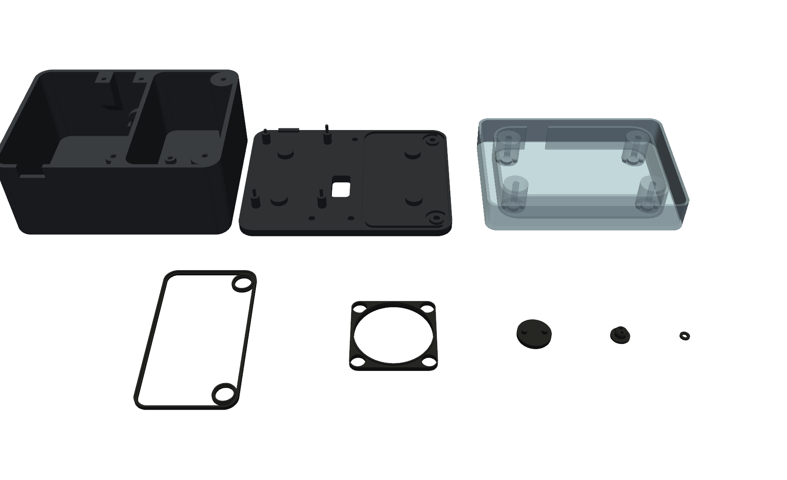
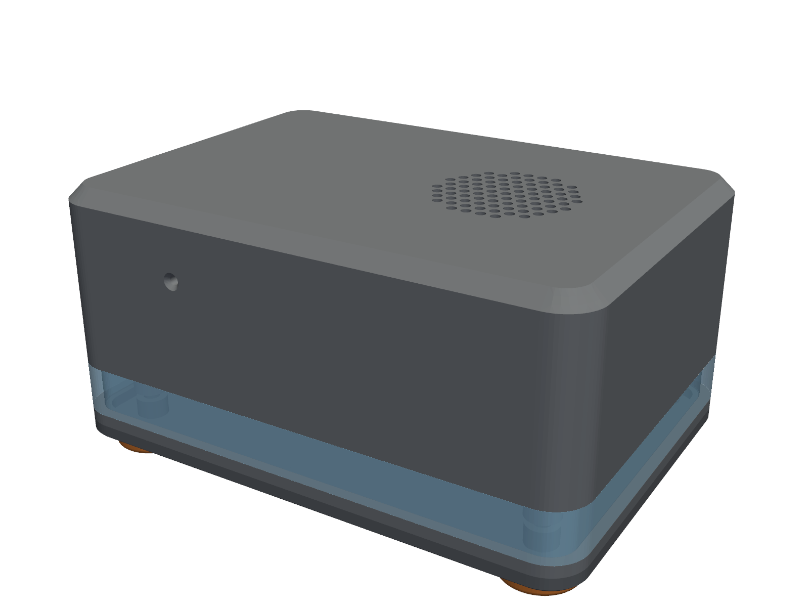

# Enclosure

Both cases are parametric [build123d](https://github.com/gumyr/build123d) code. Every STL and STEP file here is generated from `source/`, and a check script verifies collisions, seals, assembly paths and tool access.

| Version | For | Status |
|---|---|---|
| [V2](v2/) | Hand-wired perfboard build | **Printed and assembled, in use.** M3 screws threaded straight into PETG. |
| [V3](v3/) | Custom PCB rev A | **Unverified design, never printed.** Heat-set inserts. |

## V2 (built)




<!-- PHOTO NEEDED: images/v2-printed-parts.jpg: the printed V2 parts laid out flat (shell, base plate, clear plinth, TPU gaskets, feet, grommet) on a plain surface, top-down, even light, nothing else in frame. Replaces the render above. -->

**Size:** 111.2 × 85.6 × 51.4 mm case, 71.4 mm tall including the light-band plinth and the feet.

### Print settings (Bambu Lab A1 mini, 0.4 mm nozzle)

| Part (STL in [v2/stl](v2/stl/)) | Qty | Material | Notes |
|---|---|---|---|
| `shell` | 1 | PETG black | top face on the bed, no supports, ≥ 6 walls (solid screw pillars) |
| `base_plate` | 1 | PETG black | as modelled, no supports; poke through the 0.2 mm sacrificial layer in the counterbores |
| `plinth_PCTG` | 1 | PCTG clear | light band, LED strip taped around its core |
| `chamber_gasket_TPU` | 1 | TPU black | flat, 20–30 mm/s |
| `speaker_gasket_TPU` | 1 | TPU black | flat face down, rib up |
| `mic_gasket_TPU` | 1 (+2 spare) | TPU black | tiny ring |
| `feet_TPU` | 4 | TPU black | the STL holds one foot |
| `grommet_TPU` | 1 (+1 spare) | TPU black | flange on the bed; cut a slit into each wire channel |

### Hardware: ISO 7380 M3 button head, A2-70, 2 mm hex key

| Where | Qty | Screw | Thread engagement |
|---|---|---|---|
| Base plate → shell | 5 | M3×10 | 7 mm |
| Speaker → ceiling bosses (from inside) | 4 | M3×8 | 7 mm |
| Plinth → base plate | 4 | M3×20 | 5 mm |

**Why no heat-set inserts:** they weren't on hand when V2 was designed, and in an earlier iteration they couldn't be installed inside the deep chamber anyway. The screws cut their own thread in 2.6 mm pilot holes. Drive each one in and out once, re-start by hand by turning backwards until it clicks, and tighten only snug. The bosses are the hard stops for the gaskets. More in [design decisions](../docs/design-decisions.md#9-screws-straight-into-petg-v2).

**Check results:** [v2/CHECK_REPORT.txt](v2/CHECK_REPORT.txt) shows 0 failures. One item is informational: the M3 head next to the round 40 mm speaker body overlaps by 2 mm³ in the model, where the body is a sharp cylinder. My shell is printed for M3. For speakers where an M3 head doesn't sit flat, `SPK_PILOT_D` in the source switches to M2.5.

## V3 (unverified design)



**Size:** 113 × 80.2 × 54 mm (+3 mm feet). The PCB is the floor: 4 × M3×16 from below go through the base plate and the PCB into heat-set inserts in bosses hanging from the shell ceiling. The sealed speaker chamber stands on a part-free rim band of the PCB with a TPU rib gasket. A clear PCTG band in the lower wall is printed together with the black shell as one multi-material object.

### Intended print settings (untested)

| Part (STL in [v3/stl](v3/stl/)) | Material | Notes |
|---|---|---|
| `shell_black` + `shell_band_clear` | PCTG black + PCTG clear | import both as **one object with two parts** in Bambu Studio, assign filaments per part, top face on the bed, no supports, ≥ 4 walls for the 43 mm bosses |
| `base_plate` | PETG or PCTG black | flat |
| gaskets, feet | TPU black | slow |

For a **milky** light band rather than a see-through window, give the clear part 1 wall loop, 0 top/bottom shell layers and 20 % gyroid infill. Fuzzy skin on the outside is optional. This is untested; check for LED hot spots on a short test print first.

**Heat-set inserts:** M3×6×4.5 (corners, 4.3 mm holes), M3×5×4.2 (speaker, 4.0 mm holes), M3×4×4.2 (mic carrier, 4.0 mm holes). Install them first, into the bare shell, at about 260 °C.

**Check results:** [v3/CHECK_REPORT.txt](v3/CHECK_REPORT.txt).
- No collisions; the shell can be lowered over the board; the gasket groove is 75 % filled with 0.5 mm squeeze; the chamber rim sits 100 % on the PCB.
- Several keep-outs are 0.1–0.3 mm and are marked *must-measure* (USB-C, speaker wires, module to the clear band).
- The overhang check flags two things in `shell_black`'s print pose. One is the 0.5 mm steps of the 45° light lip. The other is the face where the black shell meets the clear band: in a multi-material print that face rests on the band, but the check looks at each part on its own. Neither flag has been confirmed or ruled out by a test print.

## Regenerate

```bash
pip install build123d trimesh pyvista
python3 v2/source/case_v2.py && python3 v2/source/check_case_v2.py
python3 ../hardware/v3-pcb/source/satellite_v3_pcb.py     # V3 needs the board geometry first
python3 v3/source/case_v3.py && python3 v3/source/check_case_v3.py
```

Each case writes `stl/` (print orientation), `step/` (assembly with simplified component models), `renders/`, `CHECK_REPORT.txt`, and a git-ignored `build/` folder.
