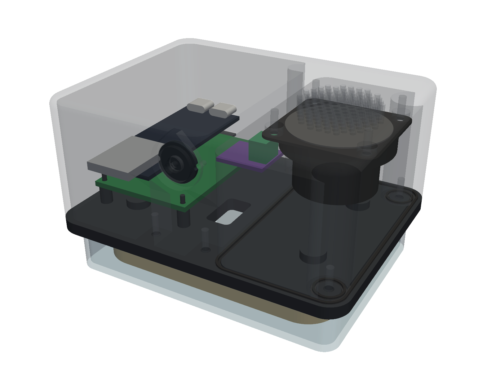
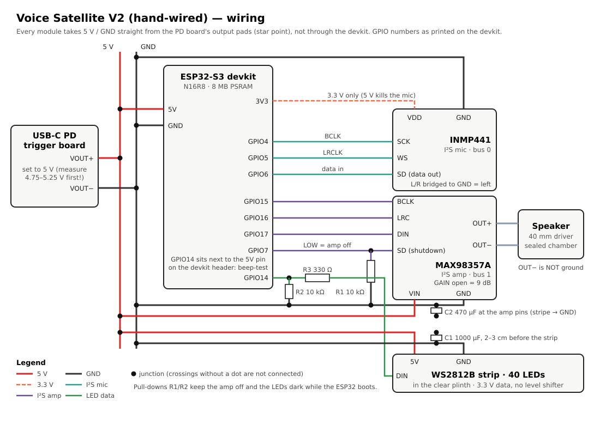

# Satellite V2 (hand-wired)

**Status: built and working.** Perfboard electronics in the [V2 enclosure](../../enclosure/v2/), running the [V2 firmware](../../firmware/esphome/voice-satellite-v2.example.yaml).

<!-- PHOTO NEEDED: images/v2-perfboard.jpg: top view of the perfboard on the base plate (devkit, amp, PD trigger board, R1-R3, C2, wire colours readable), shell removed, even light, no devkit MAC/serial sticker readable. Replaces the render above. -->

## Wiring diagram

The background is in [docs/wiring.md](../../docs/wiring.md). In the build, R2's ground end goes to the devkit's GND header pin. That's the same circuit as drawn.

## Pin table (ESP32-S3 N16R8 devkit)

| Function | Module pin | GPIO | Wire colour (as built) |
|---|---|---|---|
| Mic SCK (bit clock) | INMP441 SCK | 4 | yellow |
| Mic WS (word select) | INMP441 WS | 5 | green |
| Mic SD (data out) | INMP441 SD | 6 | white, flagged "SD mic" |
| Amp BCLK | MAX98357A BCLK | 15 | yellow |
| Amp LRC | MAX98357A LRC | 16 | green |
| Amp DIN | MAX98357A DIN | 17 | blue |
| Amp shutdown (+10 kΩ to GND) | MAX98357A SD | 7 | white, flagged "SD amp" |
| LED data (330 Ω in series, 10 kΩ to GND) | strip DIN | 14 | green |
| Mic supply | INMP441 VDD | 3V3 pin | red, flagged "3V3" |

## Power connections

| From | To | Notes |
|---|---|---|
| PD board VOUT+ | devkit 5V, amp VIN, LED strip 5 V | three separate wires from the pad, 22 AWG to the strip |
| PD board VOUT− | devkit GND, amp GND, mic GND, LED strip GND | four separate wires from the pad |
| devkit 3V3 | mic VDD | 3.3 V only |
| amp VIN ↔ GND | C2 470 µF / 16 V | at the amp pins, stripe to GND |
| strip 5 V ↔ GND | C1 1000 µF / 16 V | 2–3 cm before the strip |
| amp SD ↔ GND | R1 10 kΩ | amp off while the ESP32 boots |
| GPIO14 ↔ GND | R2 10 kΩ | strip dark while the ESP32 boots |
| amp OUT+ / OUT− | speaker + / − | OUT− is **not** ground |

## Parts

| Part | Notes |
|---|---|
| ESP32-S3 devkit N16R8 (dual USB-C, DevKitC-1-style header) | on female headers, 8.5 mm above the perfboard |
| INMP441 round I²S mic breakout (14 mm) | L/R bridged to GND on the board |
| MAX98357A I²S amp breakout | GAIN open (9 dB) |
| USB-C PD trigger board, 5 V | sits under the perfboard, receptacle through the back wall |
| WS2812B strip, 144 LED/m, 5 V, 40 LEDs | taped around the core of the clear plinth |
| 40 mm full-range speaker | sealed chamber, wires through a TPU grommet |
| 40 × 60 × 2 mm perfboard | heat-staked to the base plate |
| C1 1000 µF/16 V, C2 470 µF/16 V, R1/R2 10 kΩ, R3 330 Ω | |
