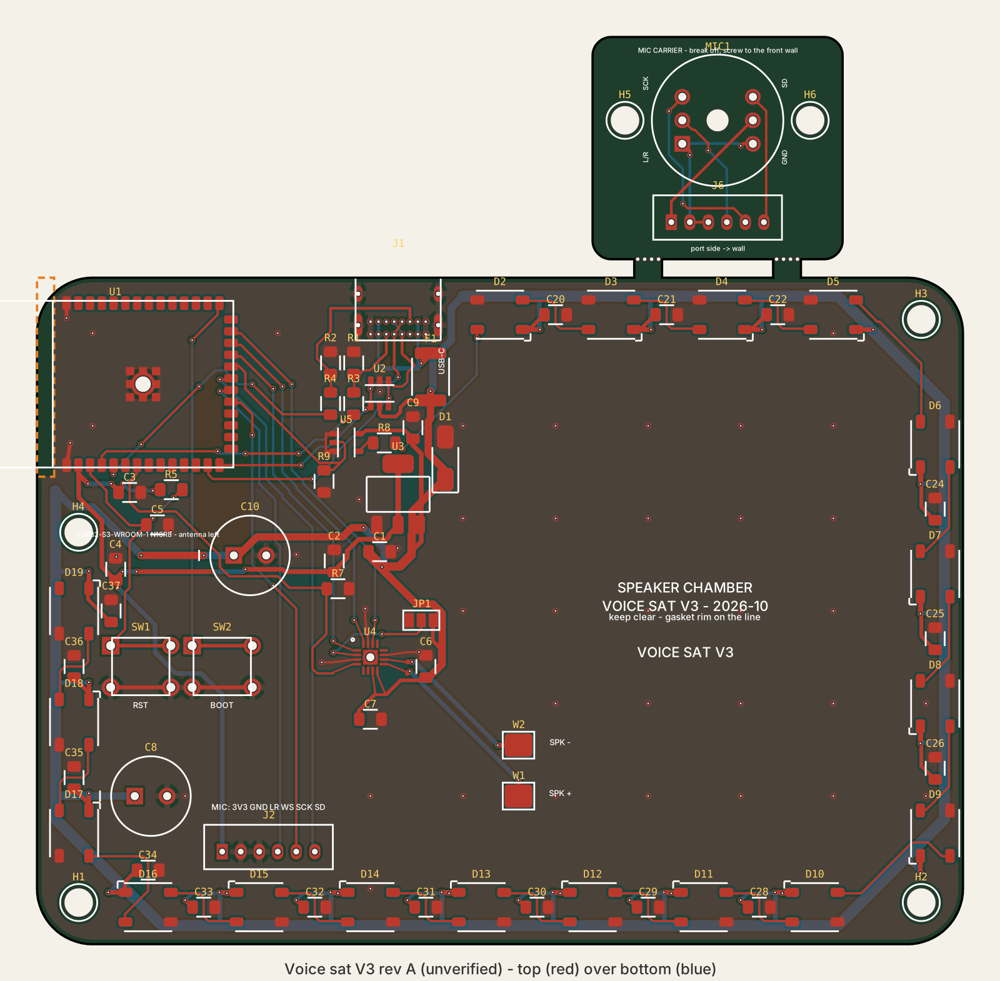

# Satellite V3 (custom PCB): unverified design, rev A

> [!WARNING]
> **Unverified design (rev A).** This board has been **designed, not fabricated, not tested, and it may never be built.** It was generated as code and has only been checked in code (see [What was checked](#what-was-checked)). KiCad's own DRC has not been run, and the footprints for the ESP32 module and the USB-C receptacle are re-creations from datasheet dimensions. Treat it as the next iteration I designed after the lessons from V2, not as a finished product.

## What it is

A 100 × 72 mm, 2-layer main board that replaces V2's perfboard, devkit, PD trigger board, amp breakout and about 20 hand-run wires. A 27 × 24 mm mic carrier is attached as a breakaway with mouse bites, so the panel is 100 × 98 mm and fits the cheapest ≤ 100 × 100 mm fab tier. It fits the [V3 enclosure](../../enclosure/v3/), which is also unverified.

| Block | Parts | Notes |
|---|---|---|
| MCU | ESP32-S3-WROOM-1-N16R8 | antenna 4.3 mm over the left board edge, copper-free keep-out on both layers |
| USB-C | GCT USB4085-GF-A (through-hole), PTC 3 A, SMAJ5.0A TVS, USBLC6-2SC6 | 5.1 kΩ Rd on CC1/CC2 (no PD IC), CC voltage sensed on IO4/IO5, native USB on IO19/IO20 for flashing and logs |
| 3.3 V | TLV1117LV33 (AMS1117-3.3 footprint-compatible) | EN RC 10 kΩ / 1 µF, RESET and BOOT buttons |
| Audio out | MAX98357A (TQFN-16) with a 1 mm back-solder hole under the exposed pad | gain jumper, SD on IO7 with pull-down, speaker wires solder to two pads **inside** the sealed chamber |
| Mic | JST-PH 6 on the main board, mic module on the breakaway carrier | carrier screws to the front wall; SCK/WS/SD on IO11/IO12/IO13 |
| LEDs | 18 × WS2812B-5050 around the board edge, 74AHCT1G125 buffer | data on IO14, chain clockwise from the back-left; 5 V ring on the bottom layer |
| Bulk | 2 × 470 µF / 10 V radial | at the LED bus entry and near the amp |

**Firmware pin changes vs V2:** mic IO4/5/6 → IO11/12/13, amp IO15/16/17 → IO47/48/21, amp SD (IO7) and LED data (IO14) unchanged, CC sense on IO4/IO5 is new. Draft firmware: [voice-satellite-v3.example.yaml](../../firmware/esphome/voice-satellite-v3.example.yaml).

## What was checked

Run on 2026-11-15 when this repository was prepared, by regenerating everything from [source/](source/):

| Check | Tool | Result |
|---|---|---|
| Routing | pcbkit A* router | 0 failed connections |
| Geometric DRC: clearance 0.15 mm, copper-to-edge 0.3 mm, hole-to-hole 0.25 mm, annular ring 0.15 mm, courtyards | pcbkit (shapely) | **0 issues**. 12 notes at exactly 0.150 mm, all inside the USB-C receptacle's 0.85 mm pin field ([drc_report.txt](drc_report.txt)) |
| Connectivity, 47 nets | pcbkit | 46 nets are one copper island each. GND is the main plane plus 5 small pad-less fill pieces on the top layer (dead copper, largest about 19 mm²). **No GND pad or track is disconnected.** KiCad recomputes all fills on "Fill all zones". |
| Gerber read-back | gerbonara (independent parser), [source/check_outputs.py](source/check_outputs.py) | all 9 layers and both drill files parse (bottom paste is empty: no bottom SMD parts). Copper and silkscreen rendered and inspected ([renders/](renders/)). |
| KiCad file syntax | kiutils, [source/check_outputs.py](source/check_outputs.py) | `.kicad_pcb` (82 footprints, including 8 mouse-bite holes) and `.kicad_sch` (74 symbols) parse |
| Case fit | [enclosure/v3](../../enclosure/v3/) check script, using `board_for_case.json` | no collisions with the case model; the chamber gasket rim lands 100 % on the board |

**Not checked:** KiCad DRC/ERC, fab DFM review, footprint accuracy against the real parts, any electrical behaviour. None of it has been built.

**Found and fixed while preparing this repo:** the Gerber writer erased silkscreen text inside the speaker-chamber outline. A clear-polarity hole was written after the text it overlapped, and the generator now writes outer shapes first. The read-back render above was made after the fix.

**Known cosmetic issue (left as designed):** the module label "ESP32-S3-WROOM-1 N16R8 - antenna left" runs over the H4 mounting hole, so part of it is clipped on the silkscreen.

## Must-verify before ordering

1. Open `kicad/voice_sat_v3.kicad_pro` in KiCad 9 → **Edit → Fill all zones**, run **DRC**. Expect only the USB-C pin-field notes.
2. **Change Footprint** of U1 to `RF_Module:ESP32-S3-WROOM-1` and of J1 to `Connector_USB:USB_C_Receptacle_GCT_USB4085` from KiCad's own library, then re-run DRC. Keep the antenna over the left edge.
3. Confirm on the GCT drawing that the USB4085's front face sits **2.5 mm past the board edge** (an estimate here) and that the body is 3.46 mm high. The case cutout depends on both.
4. Check the mic module's pin order against the carrier silkscreen, and the speaker polarity.
5. **Re-plot the Gerbers from KiCad** (File → Fabrication Outputs) and order those. The Gerbers in [gerbers/](gerbers/) come straight from the generator and are meant as a cross-check.

**Intended order settings:** 2 layers, FR4 1.6 mm, 1 oz copper, HASL lead-free, tented vias, no stencil (hand soldering).
**Rough cost estimate (not quoted):** CHF 25–45 for a batch of 5–10 boards including shipping, plus about CHF 25–35 in parts per board.

## Hand-soldering plan (iron only, untested)

1. Small SMD parts first (0805, SOT-23, SOT-223, SMA, 1812), with plenty of flux.
2. U4 MAX98357A (TQFN-16): tin the pads lightly, place, drag-solder each side, then heat the exposed pad through the 1 mm hole from the back until solder wicks through.
3. U1 module: tack two corner castellations, then solder the rest. The 1.8 mm hole under the EPAD is optional (ground/thermal only).
4. LEDs: the cut corner is pin 1 (VDD). Keep the iron under 2 s per pad.
5. Through-hole parts last: USB-C (0.85 mm pitch, solder the shell stakes well because they take the plug force), JST, buttons, capacitors.
6. Bring-up: only the LDO and its passives → check 3.3 V; then the module → the PC should see a USB serial device; then the rest.

## Files

| Path | Content |
|---|---|
| [source/pcbkit.py](source/pcbkit.py) | PCB-as-code toolkit: footprints, router, zones, DRC, KiCad 9 and Gerber writers (MIT) |
| [source/satellite_v3_pcb.py](source/satellite_v3_pcb.py) | The board: parts, nets, placement, routing order, outputs (MIT) |
| [source/check_outputs.py](source/check_outputs.py) | Independent read-back of the Gerbers, drill files and KiCad files (MIT) |
| [kicad/](kicad/) | KiCad 9 project, PCB, machine-generated schematic, `satellite.pretty` footprint library |
| [gerbers/](gerbers/) | RS-274X and Excellon (slots as G85) from the generator |
| [bom.csv](bom.csv), [positions.csv](positions.csv) | BOM with part numbers, placement |
| [drc_report.txt](drc_report.txt) | Output of the geometric DRC |
| [board_for_case.json](board_for_case.json) | Outline, holes and part envelopes for the case script |
| [renders/](renders/) | Copper overlay renders (SVG from the generator, PNG copies) and Gerber read-back renders |

Regenerate with `pip install shapely numpy matplotlib` and then `python3 source/satellite_v3_pcb.py` (about 25 s). It writes the KiCad project, Gerbers, drill files, BOM, positions, DRC report, `board_for_case.json` and the two SVG renders. Router and DRC are deterministic: a fresh run reproduces all of these byte for byte, except that the KiCad files get new UUIDs on every run.

Repeat the read-back with `pip install gerbonara kiutils` and `python3 source/check_outputs.py`. It prints what each file parses to and writes read-back SVG renders of both sides to `build/` (git-ignored). The PNG files in [renders/](renders/) were made once from the SVGs and the read-back while this repository was prepared; no script here regenerates them.

## Datasheets

Linked, not copied:
- [ESP32-S3-WROOM-1 datasheet](https://documentation.espressif.com/esp32-s3-wroom-1_wroom-1u_datasheet_en.pdf) and the [Espressif ESP32-S3 PCB layout guide](https://docs.espressif.com/projects/esp-hardware-design-guidelines/en/latest/esp32s3/pcb-layout-design.html)
- [GCT USB4085](https://gct.co/connector/usb4085)
- [MAX98357A datasheet (Analog Devices)](https://www.analog.com/media/en/technical-documentation/data-sheets/MAX98357A-MAX98357B.pdf)
- [ICS-43434 datasheet](https://www.farnell.com/datasheets/2632666.pdf)
- [PCBWay capabilities](https://www.pcbway.com/capabilities.html), used for the design rules
